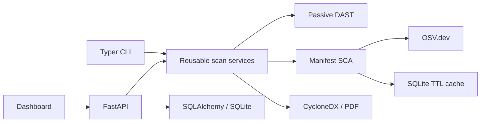

# DePGuard

Defensive application-security tooling for passive web configuration checks and open-source dependency analysis.

> Use DePGuard only on systems you own or are explicitly authorized to assess. URL scans require confirmation, make one bounded GET, and do not follow redirects. See [SECURITY.md](SECURITY.md).

## Current Capabilities

- Parse `package.json`, npm lockfiles v1-v3, `requirements.txt`, `pyproject.toml`, and `Pipfile.lock` without installing dependencies.
- Query OSV with bounded concurrency, SQLite TTL caching, and offline/stale-cache fallback.
- Produce CycloneDX 1.5 JSON and PDF reports; export scan history as JSON or CSV.
- Run passive HTTP header, cookie-attribute, and version-disclosure checks.
- Require URL-scan authorization and deny private, loopback, link-local, and metadata destinations by default.
- Provide a Typer CLI, FastAPI session-auth API, SQLite storage, and a static dashboard.

The project is an early functional vertical slice, not yet the full roadmap in the original specification. In particular, crawling and probes, NVD/CVE.org/EPSS/KEV feeds, SPDX, complete admin/RBAC workflows, file-upload scans, migration history, and live progress streaming are not implemented. Current scan profiles select interface values but all execute the same passive checks.

## Quick Start

```bash
python -m pip install -e '.[dev]'
depguard db seed
depguard user create admin admin@example.test
depguard serve
```

Open `http://127.0.0.1:8000`. Configure a persistent `DEPGUARD_SECRET_KEY` and HTTPS before deployment. See [.env.example](.env.example) for settings.

Dependency scan with reports:

```bash
depguard scan manifest examples/package.json examples/requirements.txt \
	--sbom cyclonedx --report pdf
```

Offline mode and CI gating:

```bash
depguard scan manifest examples/requirements.txt --offline --fail-on high
```

Authorized passive URL scan:

```bash
depguard scan url https://your-authorized-host.example --profile quick --auth-confirm
```

Local/private targets are blocked by default. To use a lab, set `DEPGUARD_ALLOW_PRIVATE_TARGETS=true` only for an isolated environment. Link-local and metadata addresses remain blocked.

## Architecture



## Commands

| Command | Purpose |
| --- | --- |
| `depguard scan manifest FILE...` | Scan dependency manifests; supports `--offline`, `--sbom cyclonedx`, `--report pdf`, and `--fail-on` |
| `depguard scan url URL --auth-confirm` | Run passive checks for an authorized URL |
| `depguard scan full --url URL --manifest FILE --auth-confirm` | Combine passive URL and manifest checks |
| `depguard history` | List locally persisted API scans |
| `depguard report SCAN_ID --format json\|csv\|pdf` | Export a stored scan |
| `depguard cache stats\|clear\|update FILE...` | Inspect, clear, or populate the advisory cache |
| `depguard db init\|seed` | Initialize schema and base roles |
| `depguard user create USER EMAIL` | Create a local user interactively |
| `depguard serve` | Start the dashboard and API |

API documentation is available at `/docs`. Risk bands and the current scoring formula are documented in [docs/risk_model.md](docs/risk_model.md); architecture and known limitations are in [docs/architecture.md](docs/architecture.md).

## Development

```bash
make install
make lint
make test
```

See [docs/testing_against_labs.md](docs/testing_against_labs.md) before connecting to intentionally vulnerable training applications.
# DePGaurd