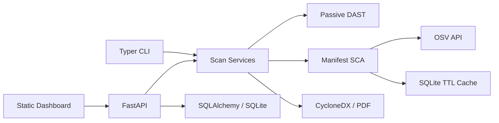

# Architecture

The CLI and FastAPI adapters call reusable SCA, DAST, risk, and report services. SQLAlchemy persists accounts, target authorization, scan history, findings, and audit events. OSV is the current advisory provider with a SQLite TTL cache. The URL resolver validates DNS answers and binds requests to the validated addresses.

The current implementation is a functional early vertical slice. It does not yet include all feed providers, a crawler, safe probes, manifest upload, full RBAC/admin controls, migrations, trend reporting, or scan progress streaming.
